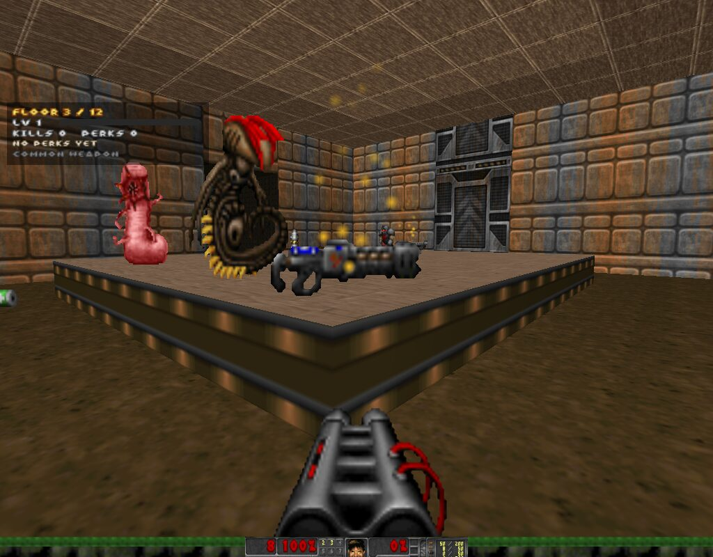

# DoomRogue

**Doom, but every run is a brand-new dungeon. One life.**

DoomRogue is a roguelike mod for [GZDoom](https://zdoom.org). Each run generates 12 new floors. You level up, pick perks, find weapons with random rarities, and fight down to a Cyberdemon on floor 12. When you die, that dungeon is gone.

**[Website, downloads and full guide →](https://c0bqlt.github.io/doomrogue/)**



## Download

Get the latest build from [**Releases**](../../releases/latest):

| OS | File | How to start |
|---|---|---|
| Windows 10/11 | `DoomRogue-windows.zip` | Unzip, double-click `DoomRogue.exe` (SmartScreen: *More info → Run anyway*) |
| macOS | `DoomRogue-mac-linux.zip` | Unzip, right-click `DoomRogue.command` → *Open* |
| Linux | `DoomRogue-mac-linux.zip` | Install GZDoom, then `python3 doomrogue.py` |

On first launch the game downloads the GZDoom engine (on Windows and macOS) and [Freedoom](https://freedoom.github.io), which provides free assets. Both downloads are checksum-verified and stored in a `data/` folder next to the game.

## Features

- **Procedural floors:** rooms, corridors, doors, pillars, raised platforms and toxic pools. The exit gate sits inside a locked vault, and the keycard is somewhere else on the floor.
- **XP and 13 stackable perks:** every level-up offers a choice of three.
- **Loot rarities:** weapons roll Common, Uncommon, Rare, Epic or Legendary, with bonus damage, crit chance and lifesteal.
- **Permadeath** with a run summary. Seeds are replayable with `--seed`.

## Running from source

```bash
python3 doomrogue.py               # play (Python 3.8+, standard library only)
python3 doomrogue.py --seed 1234   # replay a dungeon
python3 doomrogue.py --self-test   # check setup: downloads, mod, engine
python3 tests/test_generator.py    # generator invariants over 25 seeds
```

| Path | What it is |
|---|---|
| `doomrogue.py` | Launcher: seed → generate → play → repeat. It also becomes the Windows `.exe` |
| `dr_gen.py` | Level generator. Writes UDMF maps and MAPINFO into a WAD |
| `mod/` | ZScript mod (XP, perks, loot, HUD, menus, permadeath). Zipped to a `.pk3` on every launch |
| `docs/` | The website (GitHub Pages) |
| `.github/workflows/` | CI (generator + engine compile check), releases (Windows `.exe` via PyInstaller), Pages |

## Making a release

```bash
git tag v0.1.1 && git push origin v0.1.1
```

GitHub Actions builds `DoomRogue-windows.zip` and `DoomRogue-mac-linux.zip` and attaches them to a new release.

## Credits & license

- Engine: [GZDoom](https://zdoom.org) (GPL). Assets: [Freedoom](https://freedoom.github.io) (BSD).
- DoomRogue code: [MIT](LICENSE).
- DOOM is a trademark of id Software. This is an unaffiliated fan project.
